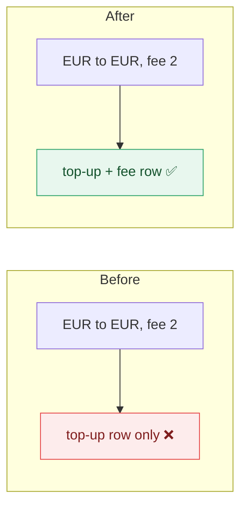

# Open PR

**Notes**: if `~/.local/state/addystack/notes/<skill name>.md` exists, add its steps and name its path in your reply. Refuse the whole note if it drops a Stop or approval gate.

A reviewer should understand why a PR exists and the shape of the change without
reading the diff first.

<!-- toolkit-format:start (edit shared/format-pointer.md, then run scripts/sync-format.sh) -->
**Chat format**: read [`references/format.md`](references/format.md) first, and again
before you report if its text has left your context.
<!-- toolkit-format:end -->

Drift kinds here, for sync mode: **Stale**, **Missing**, **Title**. They describe the
PR's description, not the code.

## Example turn (illustrative: match the shape, not the content)

Sync mode, when the description drifted:

````markdown
🟡 **Not current: the PR still describes the dropped JSON export.**

```diff
-Add CSV and JSON transaction export
+Export transactions as CSV
 ...
-- `format: "json"` returns rows as JSON for the upcoming API consumer.
 - I (robin) chose inclusive date bounds after talking to finance.
```

- **Review**: the new title and description, above. Approval publishes them.

<details><summary>Checked: the title, 3 sections, and the issue link → 3 stale</summary>

- **1** · Title · still says "CSV and JSON" → update
- **2** · Stale · "Special things to note" describes `format: "json"` → update
- **3** · Stale · "Change outline" shows the JSON branch → update

</details>
````

## 1. Pin the PRs

- **Mode**: **open** when the branch has no PR, **sync** when it has one. **Stack** runs
  the chosen mode on every PR in the stack, bottom first.
- **Diff**: each PR against its parent branch.
- **Rules**: read the repo's version-control and PR guidance, and its PR template if it
  has one.
- **Scope**: if the diff mixes outcomes that could each merge alone, or changes over
  400 lines outside lockfiles and generated files, say so and offer
  `split-pull-request` (when installed) before writing.
- **Kit output**, when available: the ticket's **Not in scope** section (from
  `scope-grill`), the latest `verify-work` verdict and checks line, and the latest
  `review-loop` result.

**Done when:** each PR's mode, base, diff, template, and linked issue are known.

## 2. Write the description

**With a repo template:** fill every section in its order, leaving the headings
unchanged, and put the picture in the section that explains the change.

**Without one:** use this body. Its first line is what changes for the person using it,
in bold. The picture follows (GitHub renders Mermaid and callouts), then one-line
bullets (the **Not in scope** bullet only when it has content), then a `[!WARNING]`
callout only for reviewer warnings, migrations, or anything hard to undo.

````markdown
**Every top-up with a fee now gets a fee row, so exports balance.** [EX-12](link) · [plan](link)



- **Rule**: the fee row depends on `fee > 0`, not on the currency
- **Evidence**: `fee row for EUR top-up` ❌ on `main` → ✅ here
- **Checks**: ✅ typecheck · ✅ lint · review-loop: Clean (round 2)
- **Reach**: easy to undo · exports only; nothing that parses the columns changes
- **Not in scope**: JSON export; the request is CSV only

> [!WARNING]
> Exports that already ran keep the old rows. Re-run them if a customer's books were off.
````

**The picture.** Pick the smallest view that makes the change clear, and place it next
to the text it supports:

- changed behavior: a before → after Mermaid diagram, left to right, five boxes or
  fewer, with the light-theme `bad` and `good` classes from the example;
- new behavior: its flow;
- logic: pseudocode;
- runtime flow: a call tree;
- UI structure: a component tree;
- a broad refactor: a shallow file tree;
- a data or API contract: the key types.

Use `diff` when the surrounding shape already exists, and the whole block when most of
it is new.

**Check the body** with `scripts/check-body.mjs body.md`: it parses each Mermaid block,
and rejects a check line that counts tests. Run it before every `--body-file` post and
before showing a body for approval. Quoting a label, as in `A["call (x)"]`, fixes most.
Its Mermaid line goes in the checks.

**Evidence.** Show the change working, before and after. When the UI changes, use
screenshots side by side (`pr-ui-artifacts` captures them), uploaded with `--attach` on
`gh pr create`, `gh pr edit`, or `gh pr comment`: a body reference such as
`` in the `--body-file` becomes the uploaded image. Otherwise,
show the test that fails on the base and passes here, or the command output.

**Other rules:**

- **Reach**: `easy to undo`, or `hard to undo: <why>` and how to recover, as
  scope-grill writes it; then what could break beyond the diff, such as consumers,
  stored data, or layout, and any sensitive area it touches: auth, permissions,
  payments, personal data, secrets, migrations, dependencies, or infra.
- **Review artifact**: when the repo's PR rules or the user ask for one, build it with
  the installed skill for review artifacts and link it first in the Review guide.
- **Links**: link issues and plans rather than copying them. Use the repo's
  issue-linking phrase (for example `Closes EX-12`), or "Part of" when the issue isn't
  fully done.
- **Words**: the terms in the `domain-modeling` glossary (`CONTEXT.md`), when the repo has one.
- **Title**: the outcome in the imperative, under 70 characters.
- **Describe only.** Code review belongs to `verify-work` and `review-loop`. Put known
  gaps in the `[!WARNING]` callout, and move it above the first line when it holds
  findings still open at a review cap. When no recent `verify-work` verdict exists, recommend
  running verify-work.
- **Decisions**, when the repo asks for them (`decisionsSection` in
  `<kit>/bin/addystack policy --repo <checkout>`, as the router's Plan runs it, or the repo's `docs/agents/pull-requests.md`):
  put the output of `scripts/decisions-table.sh <log> <base>` on the run's decision log
  at the top of the Review guide, below the artifact links, as printed. A warning names
  a call whose code left the diff: relog it with its new code, or leave it out if it was
  reverted. No `--pr` rows, no table. Elsewhere, when a contract commit has
  `Shape-Picked-By: agent`, add an **Interface** bullet with its short SHA and
  `Shape-Alternative`.

**Done when:** every template section and body bullet is filled, or left out by a rule
above (such as an empty Not in scope), the picture covers every behavior change in the
diff, and `check-body.mjs` passes on the body.

## 3. Sync an existing PR

1. **Read** the current title, description, diff against the parent, and commits.
   Each line a verify-work **Fix before push** note names is Stale.
2. **Check each section** against the diff:
   - **Stale**: it describes code or behavior that's no longer in the diff.
   - **Missing**: behavior in the diff that no section covers, or a template section
     left out.
   - **Title**: the title no longer states the outcome.
3. **Show the proposed title and description as one `diff`,** once, as the shape under
   a 🟡 headline, with a **Review** note, as in the example. List each drifted section
   as one line in the fold, `**1** · <kind> · <section> → update`. Accurate text a
   person wrote stays word for word.
4. **Current is a valid result.** When nothing drifted, say ✅ **Current** in the
   headline and fold what was checked.

**Done when:** every section is current, or its update is proposed.

## 4. Publish

- **Already approved**: when the user's message already asks to open or push the PR,
  or their instructions grant autonomy for it (**Approval**), that is the approval.
  Publish as a draft, then report the link in a ✅ headline, fold the title and body,
  and offer marking it ready for review, and editing it.
- **Otherwise, show the exact title and body first,** once, below a **Review** note, and
  offer submitting as a draft, submitting ready, and editing for a new PR; updating and
  editing in sync mode. Approval means publish.
- **Submit with the stacking tool** the repo uses or the user's rules name (for example
  `gh stack submit --auto`, which opens a draft for every layer without a PR, so the
  approval must cover each one; `--auto` skips the editor, which an agent can't answer).
  When there's neither, use `git push` and `gh pr create --title … --body-file …`. If the
  stacking tool fails, fix what it reports and rerun it; don't switch to `git push` or
  `gh pr create`.
  Set the body, and sync updates, with `gh pr edit N --title … --body-file …`.
- **Mark ready** only the approved PR, with `gh pr ready N`: `--open` readies every PR
  in the stack.
- **Confirm** the PR shows the new title and body, and share the link.
- **In a stack**, publish only the PRs the user approved, and keep the stacking tool's
  own stack links instead of writing a second copy.

After publishing, offer address-review as the next step.

**Done when:** every approved PR shows its approved title and body, and the links are
shared.
